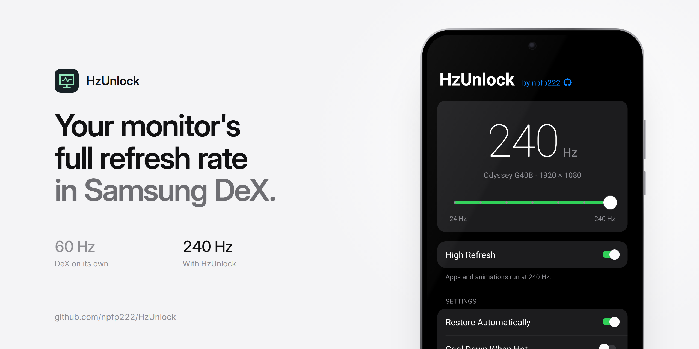

<picture>
  <source media="(prefers-color-scheme: dark)" srcset="docs/images/hzunlock-header-dark.png">
  
</picture>

# HzUnlock

HzUnlock unlocks your monitor's full refresh rate in wired Samsung DeX. Out of the box, DeX keeps apps at 60 Hz. HzUnlock lets them run at up to the monitor's own rate (240 Hz on the tested setup), or any lower rate you choose. It runs through **[Shizuku](https://shizuku.rikka.app/)** with Wireless debugging, so root is optional. There is no upper limit: the top rate is whatever the monitor connects at.

> HzUnlock is an independent project. It isn't affiliated with or endorsed by Samsung. It changes runtime display settings through hidden system interfaces. Turning it off or rebooting returns everything to Android's defaults.

## Install

1. Download the APK from [Releases](../../releases) and install it.
2. Install [Shizuku](https://shizuku.rikka.app/download/) and start it with **Wireless debugging** (or root).
3. Open HzUnlock and tap **Allow** in the Shizuku prompt.
4. Connect the monitor. **High Refresh** turns on by itself the first time; the switch turns it off.

## Compatibility

HzUnlock detects what each phone supports and uses only that. **Compatibility** in the app shows the result. For bug reports, tap **Report an Issue**: it saves the full report to Downloads and opens a prefilled GitHub issue to attach it to. **Diagnostics** shows the same report first: its report includes this summary, the monitor's fastest rate at each resolution so connection limits show up, and the session's events.

| Level | What works | Needs |
| --- | --- | --- |
| **Full** | Apps at the monitor's full rate, plus the phone screen's lower rates | Samsung's pacesetter calls in `libgui.so`, and SurfaceFlinger reporting their state |
| **Partial** | Apps at up to the phone screen's fastest rate (often 120 Hz) and its lower rates | Hidden `SurfaceControl` display-mode APIs |
| **Limited** | DeX's high-refresh mode unlock only | Samsung DeX |

**Verified:** Galaxy S24 Ultra (SM-S928U, Android 17 / One UI 9) with an Odyssey G40B at 1080p/240 Hz over a USB-C DisplayPort hub, at the Full level. Other Samsung phones, tablets, and foldables are expected to work at the level they report, but haven't been tested. Neither have rates above 240 Hz. Please open an issue with **Report an Issue** and attach the saved report.

High refresh also depends on the cable or hub. Some HDMI adapters stop at 120 Hz, and USB-C hubs that keep USB 3 data give DisplayPort only two lanes, which limits bandwidth (1440p at 144 Hz usually needs all four). The slider only offers rates the current connection really runs at.

## Features

- **One switch.** **High Refresh** unlocks DeX's high-refresh modes, lifts DeX's 60 Hz cap on apps, and sets the rate they run at. The session keeps running inside Shizuku after you close the app. Turning it off also switches DeX back to its standard modes, so the monitor reconnects at its usual rate. That's also the fix if the monitor goes black after you turn it on: some phones list modes they can't drive.
- **One slider.** Its stops are rates the system really runs at: the monitor's own rate, plus the phone panel's real modes below it. The monitor's signal stays at its connected rate, and apps and animations run at the chosen rate. A rate that doesn't divide the monitor's rate evenly (120 on a 144 Hz monitor, say) works like 60 fps video on a 144 Hz screen: frames stay up for an uneven number of refreshes, and the app says so. While High Refresh is off the slider is dimmed, since DeX's standard modes leave nothing to set.

  | Monitor | Slider stops on a Galaxy S24 Ultra |
  | --- | --- |
  | 288 Hz | 24 · 30 · 48 · 60 · 80 · 120 · 288 |
  | 240 Hz | 24 · 30 · 48 · 60 · 80 · 120 · 240 |
  | 165 Hz | 24 · 30 · 48 · 60 · 80 · 120 · 165 |
  | 144 Hz | 24 · 30 · 48 · 60 · 80 · 120 · 144 |
  | 120 Hz | 24 · 30 · 48 · 60 · 80 · 120 |
- **Monitor Mode** (Snapdragon phones, or root). Starts the monitor in another mode it lists. A monitor that starts at 60 Hz but lists 144 Hz gets a one-tap **Start at 144 Hz**; a TV stuck at 4K 60 gets the largest mode at 120 Hz; a 288 Hz connection gets 144 Hz as a fallback. Other modes are grouped by resolution. The monitor goes dark for a few seconds, then you tap **Keep**. If you don't within 20 seconds, High Refresh turns off and DeX goes back to its standard modes. A kept mode is set again each time that monitor connects, until **Use Default**.
- **Quick Settings tile.** Toggle high refresh from the notification shade. The tile shows the live rate. Long-press it to open the app.
- **Launcher shortcut.** Long-press the app icon and choose **Toggle high refresh**.
- **Restore Automatically.** After Shizuku restarts, for example after a reboot, high refresh comes back the next time you open the app or its tile.
- **Cool Down When Hot** (off by default). When Android reports moderate heat, the rate drops to 120 Hz at most; at severe heat, to 60 Hz. It goes back up after 30 seconds of cooler readings.
- **Fix Slow Connections** (off by default). If the monitor comes up below its fastest mode, HzUnlock reconnects it once per plug-in. If it comes back at the same rate, HzUnlock stops trying and tells you the connection tops out there. **Reconnect Monitor** is also available as a button.
- **Connection hints.** When the monitor only offers 60 Hz over the current hub or cable, or reaches a faster rate at a lower resolution, HzUnlock says so.
- An iOS-style design that follows the system light/dark theme and fits phone screens and DeX windows.
- **Diagnostics.** A report you can read before sharing: the compatibility summary, a timestamped log of what the session did (monitors connecting, reconnects, rate changes, heat, errors; kept on the phone, so it survives a restart after a freeze), any saved crash of the app or its display service, and optionally the display-related lines of Android's log with e-mail addresses and long IDs masked. Save it to Downloads as a text file, share the file, copy it, or open a prefilled GitHub issue and attach the saved file, which keeps the whole report however long it is. If HzUnlock crashed, it offers the report the next time you open it.
- **Update check** (on by default). Once a day HzUnlock asks GitHub about new releases and offers to download major ones (checkpoint releases). Small updates don't pop up. **Check for Updates** under About checks right away and shows every newer release.

## How it works

The ADB shell UID holds `ACCESS_SURFACE_FLINGER`, which allows the calls below. Every hidden API is looked up at runtime, so a missing one turns its feature off instead of crashing.

- **Pacesetter.** Apps render on the vsync of SurfaceFlinger's pacesetter display. Samsung's `forcePacesetter` / `resetForcedPacesetter` calls choose it. Their numbers aren't hard-coded. `SurfaceFlingerCodes` reads the dynamic symbol table of `/system/lib64/libgui.so`, finds `BpSurfaceComposer::forcePacesetter(long)` and `::resetForcedPacesetter()`, and decodes the `MOVZ W1, #code` that each loads before `transact()`. The result is used only when each function has exactly one such constant, the two are adjacent, and SurfaceFlinger's scheduler dump has a `forcedPacesetterDisplayId` field. After every call HzUnlock reads that field back, and on any mismatch it stops using the calls and paces apps from the phone screen instead.
- **Rates.** At the monitor's rate, the monitor is the pacesetter. At any lower rate, and at every rate when pacesetter control is unavailable, the phone panel paces apps, held at a real mode with `SurfaceControl.setDesiredDisplayModeSpecs`. The policy is edited by setting fields on a freshly read copy, not through constructors that change between Android releases. On foldables, the panel that's switched on is used. SurfaceFlinger ignores policy changes on an external display after it connects, so HzUnlock doesn't touch the monitor's policy.
- **Safety.** App timing is only forced onto the monitor when that gains something: never on a 60 Hz connection, and never while DeX may still drop and re-add the monitor (the first seconds after it appears, and during and just after a reconnect, when timing moves back to the phone first).
- **DeX.** `enableHighResolutionsForExternalDesktop` lifts DeX's timing filter when the build has it.
- **Heat.** `dumpsys thermalservice` provides the thermal status.
- **Monitor Mode.** Each connect starts the monitor in its own preferred mode, and Samsung's SurfaceFlinger ignores mode requests for external displays. On Snapdragon phones the ADB shell user may call Qualcomm's display config service (`vendor.qti.hardware.display.config.IDisplayConfig`). When a monitor connects, the composer creates the display a few milliseconds before SurfaceFlinger reads its mode (6–17 ms on a Galaxy S24 Ultra). `StartModeRacer` watches for the connection and sets the chosen mode inside that gap, so SurfaceFlinger takes it as the monitor's own mode and app timing matches. The mode is kept only after the user confirms it, and a mode that loses the connection is dropped.

Root adds connect-time timing control (`vendor.display.hdmi_cfg_idx`), used for Monitor Mode instead of the shell path, and a driver-level reconnect.

## Privacy

HzUnlock uses the network for one thing: the update check, a request to `api.github.com` for this repository's list of releases. It sends no information about your phone, monitor, or usage beyond what any web request carries (your IP address and a `HzUnlock/<version>` user agent). Turn off **Check for Updates** in Settings and the app makes no network requests unless you tap **Check for Updates** under About. Diagnostics reports stay on the phone (in Downloads, if you save one) until you copy, share, or attach them yourself.

## Repository layout

| Path | Contents |
| --- | --- |
| [`app/`](app) | The Android app (Gradle project) |
| [`app/src/main/java/io/github/npfp222/hzunlock/`](app/src/main/java/io/github/npfp222/hzunlock) | `DisplayControl` (hidden API lookups), `SurfaceFlingerCodes` (call-number discovery), `RefreshSession` (control loop), `DisplayConfig` and `StartModeRacer` (Monitor Mode without root), `DisplayService` (Shizuku service), `MainActivity`, `HzTileService` |
| [`research/`](research) | The original root-based 240 Hz DeX experiment: notes, measurements, logs, screenshots, and the `HzLock` prototype that preceded this app |

## Build

Requirements: JDK 17 or later, and the Android SDK with platform 36 (set `ANDROID_HOME`). The Gradle wrapper downloads Gradle 8.13.

```powershell
cd app
.\gradlew.bat assembleDebug lintDebug
```

The debug APK is written to `app/build/outputs/apk/debug/HzUnlock-debug.apk`.

### Signed release

Release builds are shrunk with R8 (`proguard-rules.pro` keeps the Shizuku service entry points). Create your own signing key once, and keep the keystore and its passwords private:

```powershell
keytool -genkeypair -v -keystore hzunlock-release.jks -alias hzunlock -keyalg RSA -keysize 4096 -validity 10000
```

Put the keystore in `app/`, and add `app/keystore.properties`. Git ignores both.

```properties
storeFile=hzunlock-release.jks
storePassword=…
keyAlias=hzunlock
keyPassword=…
```

```powershell
.\gradlew.bat assembleRelease
```

The signed APK is written to `app/build/outputs/apk/release/HzUnlock-release.apk`. Without `keystore.properties` the build is unsigned. HzUnlock uses hidden system interfaces, so it's distributed through GitHub Releases rather than Google Play.

### Publishing releases

Publish every update as a normal (not pre-release) GitHub release with a `vX.Y.Z` tag. Small updates need nothing else: people get them through **Check for Updates** or the next popup.

To make a release a **checkpoint**, the kind the app announces with a popup, add this line anywhere in its release notes:

```markdown
<!-- notify -->
```

GitHub doesn't show HTML comments, so readers never see it. Once a day the app reads the last 30 releases. If one newer than the installed version carries the marker, it shows a popup for the newest release, which includes the checkpoint, along with the checkpoint's notes. **Skip This Version** stays quiet until a later checkpoint comes out. Drafts and pre-releases are always ignored.

## License

HzUnlock is **source-available, not open source**. You're welcome to read the code and build it yourself to verify the releases. Redistributing, republishing, or reusing it requires written permission. See [LICENSE](LICENSE) for the terms. Copyright © 2026 npfp222. All rights reserved.
